# ERD — Capstone Project App

```mermaid
erDiagram
    User ||--o| Mahasiswa : "1-1 shared PK"
    User ||--o| Dosen : "1-1 shared PK"
    User }o--o{ Role : UserRole
    User ||--o{ PasswordResetToken : ""
    Dosen ||--o| DosenPembimbingDetail : "1-1"
    Mahasiswa ||--o{ AnggotaTim : ""
    Tim ||--o{ AnggotaTim : ""
    Tim ||--o{ Proposal : ""
    Proposal ||--o{ ProposalReview : ""
    Proposal ||--o{ Resume : ""
    Mahasiswa ||--o{ Resume : ""
    Dosen ||--o{ Resume : "dosen pembimbing"
    Resume ||--o{ ResumeReview : ""
    Dosen ||--o{ Bimbingan : "dosen pembimbing (snapshot)"
    Mahasiswa ||--o{ Bimbingan : ""
    Mahasiswa ||--o| Penilaian : "1-1, 1 mahasiswa 1 nilai"
    Kuesioner ||--o{ BagianKuesioner : ""
    BagianKuesioner ||--o{ PertanyaanKuesioner : ""
    Kuesioner ||--o{ ResponKuesioner : ""
    Mahasiswa ||--o{ ResponKuesioner : ""
    ResponKuesioner ||--o{ JawabanKuesioner : ""
    PertanyaanKuesioner ||--o{ JawabanKuesioner : ""
    User ||--o{ ActivityLog : ""
    Prodi ||--o{ Dosen : ""
    Mahasiswa }o--o| Dosen : "dosen_id (pembimbing tetap)"

    User {
        uuid id PK
        varchar identifier "NIM/NIP, UNIQUE"
        text password
        varchar nama_lengkap
        varchar alamat_email "UNIQUE"
        text foto_profil "nullable"
        boolean is_active
        boolean is_account_reset "sudah reset akun (ganti email + password)"
        timestamptz created_at
        timestamptz updated_at
    }
    PasswordResetToken {
        uuid id PK
        uuid user_id FK
        text token_hash "hash SHA-256 dari token acak (UUID), bukan token mentah"
        timestamptz expires_at "15 menit dari created_at"
        timestamptz used_at "NULL = masih aktif"
    }
    Role {
        uuid id PK
        varchar nama "UNIQUE"
    }
    UserRole {
        uuid id PK
        uuid user_id FK
        uuid role_id FK
    }
    Prodi {
        uuid id PK
        varchar nama "UNIQUE"
    }
    Mahasiswa {
        uuid id PK "shared dengan User.id (FK → User.id)"
        varchar nim "UNIQUE"
        varchar kelas
        varchar angkatan
        date tanggal_masuk
        enum status "Aktif|Nonaktif|Arsip|Tuntas"
        uuid dosen_id FK "nullable, dospem tetap"
    }
    Dosen {
        uuid id PK "shared dengan User.id (FK → User.id)"
        varchar nip "UNIQUE"
        varchar bidang_keahlian
        enum status "Aktif|Nonaktif|Pindah"
        uuid prodi_id FK "nullable"
    }
    DosenPembimbingDetail {
        uuid id PK
        uuid dosen_id FK "UNIQUE"
        int batas_bimbingan
        enum status "Buka|Tutup"
    }
    Tim {
        uuid id PK
        varchar nama "UNIQUE"
        enum status "Aktif|Arsip, default Aktif"
    }
    AnggotaTim {
        uuid id PK
        uuid tim_id FK
        uuid mahasiswa_id FK "UNIQUE — 1 mhs 1 tim"
        enum peran "Ketua|Anggota"
        enum kategori_capstone "EPD|SM"
        enum status_persetujuan "Menunggu|Disetujui"
    }
    Proposal {
        uuid id PK
        uuid tim_id FK
        varchar judul
        varchar mitra
        text file "path di public/"
        enum status "Menunggu|Disetujui|Ditolak|Revisi|Arsip"
    }
    ProposalReview {
        uuid id PK
        uuid proposal_id FK
        uuid dosen_id FK "nullable"
        text catatan
        enum status "Menunggu|Disetujui|Ditolak|Revisi — enum terpisah (StatusReviewProposal), TANPA Arsip"
    }
    Resume {
        uuid id PK
        uuid proposal_id FK
        uuid mahasiswa_id FK
        uuid dosen_id FK "nullable, dipilih saat upload"
        varchar subjudul
        text file "path di public/"
        enum status "Menunggu|Disetujui|Ditolak|Arsip"
    }
    ResumeReview {
        uuid id PK
        uuid resume_id FK
        uuid dosen_id FK "nullable"
        text catatan
        enum status "Menunggu|Disetujui|Ditolak — enum terpisah (StatusReviewResume), TANPA Arsip"
    }
    Bimbingan {
        uuid id PK
        uuid mahasiswa_id FK
        uuid dosen_id FK "nullable, snapshot dospem saat create"
        date tanggal
        text catatan
        text file_path
        varchar file_name
        int file_size
        enum status "Menunggu|Disetujui|Ditolak"
    }
    Penilaian {
        uuid id PK
        uuid mahasiswa_id FK "UNIQUE — 1 mahasiswa 1 nilai"
        int nilai "0–100 (CHECK di DB)"
        timestamptz created_at
        timestamptz updated_at
    }
    Kuesioner {
        uuid id PK
        varchar judul
        text deskripsi "NULLABLE"
        varchar periode "teks, mis. 2026I"
        enum status "Draf|Aktif|Ditutup"
        timestamptz created_at
        timestamptz updated_at
    }
    BagianKuesioner {
        uuid id PK
        uuid kuesioner_id FK
        varchar judul
        int urutan "UNIQUE(kuesioner_id, urutan), auto max+1"
        timestamptz created_at
        timestamptz updated_at
    }
    PertanyaanKuesioner {
        uuid id PK
        uuid bagian_id FK
        enum tipe "Likert|Esai"
        text teks
        boolean wajib "default true"
        int urutan "UNIQUE(bagian_id, urutan), auto max+1"
        timestamptz created_at
        timestamptz updated_at
    }
    ResponKuesioner {
        uuid id PK
        uuid kuesioner_id FK
        uuid mahasiswa_id FK "UNIQUE(kuesioner_id, mahasiswa_id)"
        enum status "Draf|Selesai"
        timestamptz submitted_at "NULLABLE, wajib saat Selesai"
        timestamptz created_at
        timestamptz updated_at
    }
    JawabanKuesioner {
        uuid id PK
        uuid respon_id FK
        uuid pertanyaan_id FK "UNIQUE(respon_id, pertanyaan_id)"
        smallint nilai "1–5 (CHECK), NULLABLE (Likert)"
        text jawaban_teks "NULLABLE (Esai)"
        timestamptz created_at
        timestamptz updated_at
    }
    ActivityLog {
        uuid id PK
        enum entity "Tim|Proposal|Resume"
        uuid entity_id "polimorfik, TANPA FK"
        uuid user_id FK "nullable"
        text pesan
        enum warna "Neutral|Danger|Warning|Success|Info"
    }
```

---

## Tabel (detail constraint)

### Auth & Role

**User**
| Field | Tipe | Constraint | On Delete |
|---|---|---|---|
| id | UUID | PK | — |
| identifier | VARCHAR | UNIQUE, NOT NULL (NIM/NIP) | — |
| password | TEXT | NOT NULL | — |
| nama_lengkap | VARCHAR | NOT NULL | — |
| alamat_email | VARCHAR | UNIQUE, NOT NULL | — |
| foto_profil | TEXT | NULLABLE | — |
| is_active | BOOLEAN | NOT NULL, DEFAULT true | — |
| is_account_reset | BOOLEAN | NOT NULL, DEFAULT false — penanda **sudah reset akun (ganti email + password)** (bukan password saja) | — |
| created_at | TIMESTAMPTZ | NOT NULL | — |
| updated_at | TIMESTAMPTZ | NOT NULL | — |

**PasswordResetToken** (token reset lupa-password)
| Field | Tipe | Constraint | On Delete |
|---|---|---|---|
| id | UUID | PK | — |
| user_id | UUID | FK → User.id, NOT NULL (1 token aktif per user — request baru menimpa lama) | CASCADE |
| token_hash | TEXT | NOT NULL (hash SHA-256 dari token acak `crypto.randomUUID()`; token mentah **tidak** disimpan) | — |
| expires_at | TIMESTAMPTZ | NOT NULL (created_at + 15 menit) | — |
| used_at | TIMESTAMPTZ | NULLABLE — NULL = masih aktif; terisi saat token dipakai (single-use) | — |
| created_at | TIMESTAMPTZ | NOT NULL | — |
| updated_at | TIMESTAMPTZ | NOT NULL | — |

**Role**
| Field | Tipe | Constraint | On Delete |
|---|---|---|---|
| id | UUID | PK | — |
| nama | VARCHAR | UNIQUE, NOT NULL | — |
| created_at | TIMESTAMPTZ | NOT NULL | — |
| updated_at | TIMESTAMPTZ | NOT NULL | — |

**UserRole** (junction User ↔ Role)
| Field | Tipe | Constraint | On Delete |
|---|---|---|---|
| id | UUID | PK | — |
| user_id | UUID | FK → User.id, UNIQUE composite dgn role_id, NOT NULL | CASCADE |
| role_id | UUID | FK → Role.id, UNIQUE composite dgn user_id, NOT NULL | CASCADE |
| created_at | TIMESTAMPTZ | NOT NULL | — |
| updated_at | TIMESTAMPTZ | NOT NULL | — |

### Master Data

**Prodi**
| Field | Tipe | Constraint | On Delete |
|---|---|---|---|
| id | UUID | PK | — |
| nama | VARCHAR | UNIQUE, NOT NULL | — |
| created_at | TIMESTAMPTZ | NOT NULL | — |
| updated_at | TIMESTAMPTZ | NOT NULL | — |

**Mahasiswa**
| Field | Tipe | Constraint | On Delete |
|---|---|---|---|
| id | UUID | PK **sekaligus** FK → User.id (**shared PK**: `Mahasiswa.id = User.id`, tanpa default — nilai diambil dari User yang dibuat) | CASCADE |
| nim | VARCHAR | UNIQUE, NOT NULL | — |
| kelas | VARCHAR | NOT NULL | — |
| angkatan | VARCHAR | NOT NULL | — |
| tanggal_masuk | DATE | NOT NULL | — |
| status | ENUM(Aktif, Nonaktif, Arsip, Tuntas) | NOT NULL | — |
| dosen_id | UUID | FK → Dosen.id, NULLABLE (dospem tetap, di-set saat resume Disetujui) | SET NULL |
| created_at | TIMESTAMPTZ | NOT NULL | — |
| updated_at | TIMESTAMPTZ | NOT NULL | — |

**Dosen**
| Field | Tipe | Constraint | On Delete |
|---|---|---|---|
| id | UUID | PK **sekaligus** FK → User.id (**shared PK**: `Dosen.id = User.id`, tanpa default — nilai diambil dari User yang dibuat) | CASCADE |
| nip | VARCHAR | UNIQUE, NOT NULL | — |
| bidang_keahlian | VARCHAR | NOT NULL | — |
| status | ENUM(Aktif, Nonaktif, Pindah) | NOT NULL | — |
| prodi_id | UUID | FK → Prodi.id, NULLABLE | SET NULL |
| created_at | TIMESTAMPTZ | NOT NULL | — |
| updated_at | TIMESTAMPTZ | NOT NULL | — |

**DosenPembimbingDetail**
| Field | Tipe | Constraint | On Delete |
|---|---|---|---|
| id | UUID | PK | — |
| dosen_id | UUID | FK → Dosen.id, UNIQUE (1–1), NOT NULL | CASCADE |
| batas_bimbingan | INT | NOT NULL (maks. mahasiswa aktif bimbingan + reservasi resume `Menunggu`; diisi Kaprodi) | — |
| status | ENUM(Buka, Tutup) | NOT NULL (diatur Kaprodi) | — |
| created_at | TIMESTAMPTZ | NOT NULL | — |
| updated_at | TIMESTAMPTZ | NOT NULL | — |

### Tim & Capstone

**Tim**
| Field | Tipe | Constraint | On Delete |
|---|---|---|---|
| id | UUID | PK | — |
| nama | VARCHAR | UNIQUE, NOT NULL | — |
| status | ENUM(Aktif, Arsip) | NOT NULL, DEFAULT `Aktif` — soft delete tim oleh Kaprodi (arsip = penanda, tidak mengubah alur bisnis) | — |
| created_at | TIMESTAMPTZ | NOT NULL | — |
| updated_at | TIMESTAMPTZ | NOT NULL | — |

> "Tim terbentuk" = semua `AnggotaTim.status_persetujuan = Disetujui`.
> "Tim terkunci" = derived dari `Proposal.status ∈ {Menunggu, Disetujui}`.
> Arsip/un-arsip hanya oleh Kaprodi; aksinya **tidak** di-log ke `ActivityLog`.

**AnggotaTim** (junction Tim ↔ Mahasiswa)
| Field | Tipe | Constraint | On Delete |
|---|---|---|---|
| id | UUID | PK | — |
| tim_id | UUID | FK → Tim.id, NOT NULL | CASCADE |
| mahasiswa_id | UUID | FK → Mahasiswa.id, **UNIQUE (sendiri)** — jaminan 1 mahasiswa hanya di 1 tim (termasuk saat masih `Menunggu`), NOT NULL | CASCADE |
| peran | ENUM(Ketua, Anggota) | NOT NULL | — |
| kategori_capstone | ENUM(EPD, SM) | NOT NULL (ditentukan Ketua saat invite; boleh beda dalam 1 tim) | — |
| status_persetujuan | ENUM(Menunggu, Disetujui) | NOT NULL (tolak = hapus baris) | — |
| created_at | TIMESTAMPTZ | NOT NULL | — |
| updated_at | TIMESTAMPTZ | NOT NULL | — |

### Proposal

**Proposal**
| Field | Tipe | Constraint | On Delete |
|---|---|---|---|
| id | UUID | PK | — |
| tim_id | UUID | FK → Tim.id, NOT NULL (1 proposal aktif per tim — lama dihapus saat replace) | CASCADE |
| judul | VARCHAR | NOT NULL | — |
| mitra | VARCHAR | NOT NULL | — |
| file | TEXT | NOT NULL (path di `public/`) | — |
| status | ENUM(Menunggu, Disetujui, Ditolak, Revisi, Arsip) | NOT NULL | — |
| created_at | TIMESTAMPTZ | NOT NULL | — |
| updated_at | TIMESTAMPTZ | NOT NULL | — |

**ProposalReview**
| Field | Tipe | Constraint | On Delete |
|---|---|---|---|
| id | UUID | PK | — |
| proposal_id | UUID | FK → Proposal.id, NOT NULL | CASCADE |
| dosen_id | UUID | FK → Dosen.id, NULLABLE (dosen capstone; boleh review berkali-kali) | SET NULL |
| catatan | TEXT | NOT NULL | — |
| status | ENUM(Menunggu, Disetujui, Ditolak, Revisi) | NOT NULL (feedback lanjutan = **mirror** `Proposal.status` yang terkunci) — enum **terpisah** `StatusReviewProposal`, **tanpa** `Arsip` | — |
| created_at | TIMESTAMPTZ | NOT NULL | — |
| updated_at | TIMESTAMPTZ | NOT NULL | — |

### Resume

**Resume**
| Field | Tipe | Constraint | On Delete |
|---|---|---|---|
| id | UUID | PK | — |
| proposal_id | UUID | FK → Proposal.id, NOT NULL | CASCADE |
| mahasiswa_id | UUID | FK → Mahasiswa.id, NOT NULL (1 resume aktif per mhs — lama dihapus saat replace) | CASCADE |
| dosen_id | UUID | FK → Dosen.id, NULLABLE (dospem dipilih saat upload; di-set awal saat upload) | SET NULL |
| subjudul | VARCHAR | NOT NULL | — |
| file | TEXT | NOT NULL (path di `public/`) | — |
| status | ENUM(Menunggu, Disetujui, Ditolak, Arsip) | NOT NULL (tanpa `Revisi`) — `Arsip` = soft delete oleh Kaprodi | — |
| created_at | TIMESTAMPTZ | NOT NULL | — |
| updated_at | TIMESTAMPTZ | NOT NULL | — |

> Validasi app-level: resume berstatus `Menunggu` menempati 1 slot `DosenPembimbingDetail.batas_bimbingan`; slot dilepas saat resume `Ditolak` atau dipindahkan ke dosen lain. Resume `Disetujui` dihitung lewat `Mahasiswa.dosen_id`.

**ResumeReview**
| Field | Tipe | Constraint | On Delete |
|---|---|---|---|
| id | UUID | PK | — |
| dosen_id | UUID | FK → Dosen.id, NULLABLE (**hanya** `Resume.dosen_id` yang boleh review) | SET NULL |
| resume_id | UUID | FK → Resume.id, NOT NULL | CASCADE |
| catatan | TEXT | NOT NULL | — |
| status | ENUM(Menunggu, Disetujui, Ditolak) | NOT NULL (mirror `Resume.status` yang terkunci) — enum **terpisah** `StatusReviewResume`, **tanpa** `Arsip` | — |
| created_at | TIMESTAMPTZ | NOT NULL | — |
| updated_at | TIMESTAMPTZ | NOT NULL | — |

### Bimbingan (Logbook)

**Bimbingan**
| Field | Tipe | Constraint | On Delete |
|---|---|---|---|
| id | UUID | PK | — |
| mahasiswa_id | UUID | FK → Mahasiswa.id, NOT NULL | CASCADE |
| dosen_id | UUID | FK → Dosen.id, NULLABLE (snapshot dospem saat create; selalu diisi app-level) | SET NULL |
| tanggal | **DATE** | NOT NULL | — |
| catatan | TEXT | NOT NULL | — |
| file_path | TEXT | NOT NULL | — |
| file_name | VARCHAR | NOT NULL | — |
| file_size | INT | NOT NULL (bytes) | — |
| status | ENUM(Menunggu, Disetujui, Ditolak) | NOT NULL, DEFAULT `Menunggu` | — |
| created_at | TIMESTAMPTZ | NOT NULL | — |
| updated_at | TIMESTAMPTZ | NOT NULL | — |

> Validasi app-level: (1) create hanya saat `Resume.status = Disetujui`/`Arsip`; (2) `dosen_id` disalin dari `Mahasiswa.dosen_id` saat create; (3) edit/hapus hanya saat status `Menunggu`; (4) verifikasi hanya oleh dospem pada record, status dapat diubah berulang (`Menunggu → Disetujui/Ditolak`, lalu `Disetujui ↔ Ditolak`); (5) satu file bukti pendukung (PDF/JPG/PNG/WebP, maks. 5 MB).

### Penilaian

> **Spesifikasi — implementasi menyusul** (`src/features/penilaian/`). Aturan lengkap: `docs/BUSINESS_RULES.md` §12, flow: `docs/FLOW.md` §8.

**Penilaian**
| Field | Tipe | Constraint | On Delete |
|---|---|---|---|
| id | UUID | PK | — |
| mahasiswa_id | UUID | FK → Mahasiswa.id, **UNIQUE (1–1)**, NOT NULL — 1 mahasiswa 1 nilai | CASCADE |
| nilai | INT | NOT NULL — **CHECK 0–100 di DB** (`penilaian_nilai_range`) | — |
| created_at | TIMESTAMPTZ | NOT NULL | — |
| updated_at | TIMESTAMPTZ | NOT NULL | — |

> Validasi app-level: hanya Kaprodi yang boleh memberi/mengubah/membatalkan nilai; simpan nilai menyetel `Mahasiswa.status = Tuntas`, batal nilai menghapus baris & mengembalikan `Tuntas → Aktif`; daftar penilaian hanya mahasiswa `Aktif`/`Tuntas`; import atomik (NIM terdaftar, tanpa duplikat, nilai 0–100, maks. 500 baris/5 MB); mahasiswa hanya bisa **melihat** nilai jika punya minimal 1 respons kuesioner `Selesai` (kuesioner apa pun). Tanpa `ActivityLog`.

### Kuesioner

> **Spesifikasi — implementasi menyusul** (`src/features/kuesioner/`). Aturan lengkap: `docs/BUSINESS_RULES.md` §10, flow: `docs/FLOW.md` §7.

**Kuesioner**
| Field | Tipe | Constraint | On Delete |
|---|---|---|---|
| id | UUID | PK | — |
| judul | VARCHAR | NOT NULL | — |
| deskripsi | TEXT | NULLABLE | — |
| periode | VARCHAR | NOT NULL (teks bebas, mis. `2026I`) | — |
| status | ENUM(Draf, Aktif, Ditutup) | NOT NULL, DEFAULT `Draf` | — |
| created_at | TIMESTAMPTZ | NOT NULL | — |
| updated_at | TIMESTAMPTZ | NOT NULL | — |

**BagianKuesioner**
| Field | Tipe | Constraint | On Delete |
|---|---|---|---|
| id | UUID | PK | — |
| kuesioner_id | UUID | FK → Kuesioner.id, NOT NULL | CASCADE |
| judul | VARCHAR | NOT NULL | — |
| urutan | INT | NOT NULL — `UNIQUE(kuesioner_id, urutan)`; diisi **otomatis** (`max + 1`), tanpa input manual | — |
| created_at | TIMESTAMPTZ | NOT NULL | — |
| updated_at | TIMESTAMPTZ | NOT NULL | — |

**PertanyaanKuesioner**
| Field | Tipe | Constraint | On Delete |
|---|---|---|---|
| id | UUID | PK | — |
| bagian_id | UUID | FK → BagianKuesioner.id, NOT NULL | CASCADE |
| tipe | ENUM(Likert, Esai) | NOT NULL, DEFAULT `Likert` | — |
| teks | TEXT | NOT NULL | — |
| wajib | BOOLEAN | NOT NULL, DEFAULT `true` | — |
| urutan | INT | NOT NULL — `UNIQUE(bagian_id, urutan)`; diisi **otomatis** (`max + 1`) | — |
| created_at | TIMESTAMPTZ | NOT NULL | — |
| updated_at | TIMESTAMPTZ | NOT NULL | — |

**ResponKuesioner** (respons mahasiswa terhadap 1 kuesioner)
| Field | Tipe | Constraint | On Delete |
|---|---|---|---|
| id | UUID | PK | — |
| kuesioner_id | UUID | FK → Kuesioner.id, NOT NULL | CASCADE |
| mahasiswa_id | UUID | FK → Mahasiswa.id, NOT NULL — `UNIQUE(kuesioner_id, mahasiswa_id)` (1 respons per mahasiswa per kuesioner) | CASCADE |
| status | ENUM(Draf, Selesai) | NOT NULL, DEFAULT `Draf` | — |
| submitted_at | TIMESTAMPTZ | NULLABLE — wajib terisi saat `Selesai` | — |
| created_at | TIMESTAMPTZ | NOT NULL | — |
| updated_at | TIMESTAMPTZ | NOT NULL | — |

**JawabanKuesioner** (jawaban per pertanyaan)
| Field | Tipe | Constraint | On Delete |
|---|---|---|---|
| id | UUID | PK | — |
| respon_id | UUID | FK → ResponKuesioner.id, NOT NULL | CASCADE |
| pertanyaan_id | UUID | FK → PertanyaanKuesioner.id, NOT NULL — `UNIQUE(respon_id, pertanyaan_id)` | CASCADE |
| nilai | SMALLINT | NULLABLE (untuk pertanyaan tipe `Likert`) — **CHECK 1–5 di DB** (`jawaban_nilai_range`); label UI dipetakan di aplikasi: 1=`Kurang`, 2=`Cukup`, 3=`Cukup Baik`, 4=`Baik`, 5=`Baik Sekali` | — |
| jawaban_teks | TEXT | NULLABLE — untuk pertanyaan tipe `Esai` | — |
| created_at | TIMESTAMPTZ | NOT NULL | — |
| updated_at | TIMESTAMPTZ | NOT NULL | — |

> Validasi app-level: `nilai` hanya terisi untuk pertanyaan `Likert` dan `jawaban_teks` hanya untuk `Esai` (saling eksklusif; `nilai` SMALLINT 1–5 dengan CHECK di DB — label 1–5 dipetakan di aplikasi, likert bukan enum DB). **Keberadaan baris = pertanyaan terjawab; baris dikosongkan = dihapus** (tanpa kolom `answered`). Aktivitas kuesioner **tidak** dicatat ke `ActivityLog` (entity log tidak berubah).

### Log

**ActivityLog**
| Field | Tipe | Constraint | On Delete |
|---|---|---|---|
| id | UUID | PK | — |
| entity | ENUM(Tim, Proposal, Resume) | NOT NULL | — |
| entity_id | UUID | NOT NULL — referensi polimorfik ke Tim/Proposal/Resume.id, **tidak ada FK formal** | — |
| user_id | UUID | FK → User.id, NULLABLE | SET NULL |
| pesan | TEXT | NOT NULL | — |
| warna | ENUM(Neutral, Danger, Warning, Success, Info) | NOT NULL | — |
| created_at | TIMESTAMPTZ | NOT NULL | — |
| updated_at | TIMESTAMPTZ | NOT NULL | — |

---

## Validasi app-level (tidak dijamin DB)

1. Panjang tim 2–5 anggota (cek sebelum invite & sebelum submit proposal).
2. Semua anggota `Disetujui` sebelum proposal bisa diset dosen.
3. Lock tim saat proposal `Menunggu`/`Disetujui`.
4. Edit proposal hanya saat status `Ditolak`/`Revisi`/belum submit; edit resume hanya saat `Ditolak`/belum submit.
5. Dosen capstone pertama yang set status mengunci proposal; lainnya mirror status.
6. Hanya `Resume.dosen_id` yang boleh review resume.
7. `Mahasiswa.dosen_id` di-set saat resume `Disetujui`.
8. Bimbingan: prasyarat resume `Disetujui`/`Arsip`; `dosen_id` snapshot dari `Mahasiswa.dosen_id`; edit/hapus hanya saat `Menunggu`; verifikasi hanya oleh dospem pada record, dari `Menunggu` ke `Disetujui`/`Ditolak`.
9. Force **reset akun (ganti email + password)** saat `is_account_reset = false` — semua route ditolak kecuali `/reset-akun`.
10. Reset password: input **email atau NIM/NIP**, token hash (UUID → SHA-256) 15 menit single-use, maks. 1 token aktif per user (request baru menimpa), hanya untuk akun `is_account_reset = true`, password baru min 8 karakter (lihat `docs/BUSINESS_RULES.md` §1).
11. Kuesioner: struktur (metadata/bagian/pertanyaan) hanya editable saat `Draf`; kelengkapan struktur (≥1 bagian, tiap bagian ≥1 pertanyaan) divalidasi **hanya saat publish**; `Ditutup` final (tanpa reopen); hapus hanya `Draf`; `urutan` diisi otomatis.
12. Pengisian kuesioner: prasyarat resume `Disetujui`; hanya kuesioner `Aktif`; 1 respons per mahasiswa per kuesioner; jawaban harus milik pertanyaan di kuesioner tersebut; draft disimpan per bagian (baris jawaban = terjawab, dikosongkan = dihapus); submit final memvalidasi **seluruh** pertanyaan wajib di server lalu set `Selesai` + `submitted_at`.
13. Penilaian: hanya Kaprodi; nilai integer 0–100; simpan/ubah nilai menyetel `Mahasiswa.status = Tuntas` (batal nilai → `Aktif`); daftar hanya mahasiswa `Aktif`/`Tuntas`; import atomik (NIM terdaftar & `Aktif`/`Tuntas`, tanpa duplikat, nilai valid, upsert); nilai hanya tampil ke mahasiswa jika punya ≥1 respons kuesioner `Selesai`.
